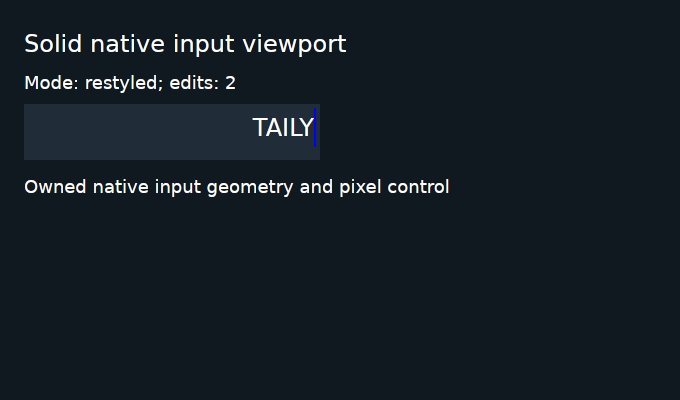
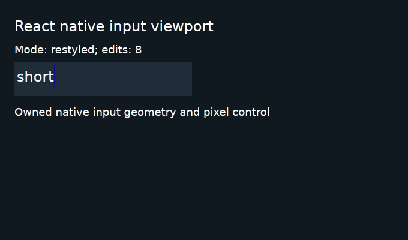

# Native viewport results and React retention failure: November 4, 2026

This research archive preserves one exact execution of
[Validation 41912545706](https://github.com/0xPlayerOne/bun-native/actions/runs/41912545706)
for [PR #377](https://github.com/0xPlayerOne/bun-native/pull/377). All four new
viewport cases passed their actual native assertions. The required Linux job
and aggregate gate failed because an earlier React calibration retained two
WeakRef targets. The viewport results do not override that failure.

This branch changes no product source, workflow, deadline, assertion or GC
checkpoint. No application, native host, GC workload or failed job was executed
again while preparing the archive. Archive checks only read source, records,
PNG pixels and executable bytes; they do not execute the retained code.

## Exact source and gate results

| Identity                | Recorded value                                                     |
| ----------------------- | ------------------------------------------------------------------ |
| Pull request head       | `d4a1db9ae1067e694062b8590870fea384166232`                         |
| Tested merge            | `78bb6d62426a3a7133c5c72db1696e21e09b81cc`                         |
| Tested tree             | `6b4eeeb8d08fe9d25e9923cbd2448006c8ba1d64`                         |
| Equivalent local source | `9c84b7abe3596aef8eddc08344e4027e0e8e87e7`                         |
| Linux job               | `126863607390`                                                     |
| Platform                | Linux x64, isolated X11/XTest, software llvmpipe                   |
| Bun revision            | `da867c60bf0bcbf9d6d36994f8ca0efa42075115`                         |
| Release native host     | 29,507,712 bytes                                                   |
| Host SHA-256            | `4dd3f8da1fad4caf6c56f85f32d4f2a92c516ab6f0a527b2f0602d024f1ba075` |

Ten of eleven implementation jobs passed. Native Linux failed only step 27,
the React update and lifecycle diagnostics. The aggregate Validation gate
therefore failed. All four actual CodeQL analyses and aggregate CodeQL check
`126864139368` passed in run `41912546455`. This source was not eligible to merge
on those results.

All 117 source records in each viewport result and all 89 source records in
each of the three relevant package manifests match the tested tree. Their
union contains 125 unique paths, retained in [source-hashes.json.raw](source-hashes.json.raw).
Clean-source receipts, generated-module hashes and the actual archived native
host bytes were verified. These checks do not change any original outcome.

## Actual viewport qualification: partial #241 scope

| Adapter | Development | Inspected AOT | Final application and process cleanup                         |
| ------- | ----------- | ------------- | ------------------------------------------------------------- |
| Solid   | Passed      | Passed        | Exit 0, unforced; no remaining or unreaped observed processes |
| React   | Passed      | Passed        | Exit 0, unforced; no remaining or unreaped observed processes |

The audit checked all **44 retained complete-tree/state/geometry frames** and
reproduced all **28 screenshot predicates** directly from the original PNGs.
It checked fresh matching native and public input-listener pointer pairs
against their recorded offsets. All four cases use distinct evidence nonces.

The observed flow covers visible End/Home carets, clipped glyphs, scrolled-end
pointer insertion, selected-character replacement, resize, font restyle,
full-selection clipping, clear/reset and short text. Every case recorded eight
edits, one restyle and 43 native events. Final OS close revoked six observed
callback signals, disposed the framework owner, and joined application/host
shutdown with all seven public ownership counters zero. There was no forced
termination or discarded stdout/stderr evidence.

The opaque-caret correction was exercised by this source. The original
blue-fringe false positive remains preserved at its earlier source in
[archive #385](https://github.com/0xPlayerOne/bun-native/pull/385). These new
results do not relabel that earlier failed scenario.

The two viewport AOT manifests record genuine compiled programs and JIT
omission. The AOT cases executed their compiled application paths. The native
driver does not independently repeat the binary inspection, and the AOT
executable bytes were not retained in the original ZIP. The original
manifests, inspection/build logs and generated JavaScript/source maps are
preserved here without alteration.

This is Linux x64 software-GPU qualification. It does not establish IME
composition, bidirectional text, accessibility, physical input/GPU behavior,
high-DPI, macOS/Windows viewport acceptance or long-soak behavior. The broader
[#241](https://github.com/0xPlayerOne/bun-native/issues/241) scope remains open.

## Separate current-head collectability failure: #287

The first React **development calibration** failed at
`benchmarks/solid/workload.ts:352`:

> Disposed view/callback targets remain observable

The assertion observed **2** targets and expected **0**. Its original report
records `firstReachable = [3, 5]` and `stillReachable = [3, 5]` at the existing
two collection checkpoints. The fixed three-probe order maps index 3 to the
second mount's render root and index 5 to its listener. The retaining
root/cause is unknown; identifying the target kinds does not identify what
kept them alive.

The calibration used 10 updates, 10 rotations, two mounts and 32 rows, with the
existing 20-update warmup. Its lifecycle report records 64 rows created and
disposed and two acknowledged lifecycle updates. Application diagnostics
after shutdown are all zero. That does **not** satisfy the failed WeakRef
collectability assertion or prove its retaining cause.

The production package tree and React workload/shared ownership/source
helpers are byte-identical to accepted main `27405939`. No causal attribution
to the viewport correction follows from this source comparison. The
development 1,000-mount workload, AOT calibration and AOT 1,000-mount workload
did **not** run after the calibration failure. The raw calibration JSON, log,
native-paint records and session log are all preserved.

[#287](https://github.com/0xPlayerOne/bun-native/issues/287) remains unresolved.
Earlier `af956a` failures remain separately preserved in the closed-unmerged
[protocol archive #383](https://github.com/0xPlayerOne/bun-native/pull/383) and
[native archive #385](https://github.com/0xPlayerOne/bun-native/pull/385).

## Archive contents, hashes and omissions

The original GitHub artifact `13364356955` is **24,886,325 bytes**, SHA-256
`725bffb7800c227f3133d3810d848fa1464abb8e335164643cf3f03ecfa87537`.
The [complete inventory](archive-inventory.json.raw) gives all **1,615** original
regular members' sizes, SHA-256 hashes and inclusion flags.

[original-qualification-evidence.tar.gz](original-qualification-evidence.tar.gz)
contains **128 exact regular files**, totaling **10,381,013 uncompressed file
bytes**. It is **1,797,085 bytes**, SHA-256
`36523feb7185a3fcea4ae3cf2dec490207e72da5c42637cfe055f4828041ab00`.
All members have safe, unique relative paths. Every archived payload was
compared byte-for-byte with its original ZIP member or decoded job log.

The archive contains all four viewport case and session directories, the
React calibration failure, all three relevant package directories, toolchain,
native host hash/size/build receipts and the complete decoded job log. It
includes the actual generated JavaScript and source maps for those packages.
The two preview PNGs above are additional byte-identical copies.

The full original ZIP, native-host executable archive, and unrelated scenario
payloads are **not** copied into this branch. Their sizes, hashes and omission
flags remain in the inventory. No AOT application binaries were present in
the original artifact. This bounded archive does not replace that artifact or
claim a passed overall qualification.

The complete decoded job log is `complete-job-126863607390.log`: **1,207,048
bytes**, SHA-256
`2782525255ed2dfd9bf0c595d12a03492e2710418d14b1c9f78d4658356aa751`.
Paths beginning with `raw/` in the audits refer to the original artifact root;
the tar archive uses the corresponding relative path without that prefix.

The unchanged authored audit records are:

- [qualification-summary.json.raw](qualification-summary.json.raw): 9,395 bytes,
  SHA-256 `240e916527d94b45b38f45ac0d9ac90da7b1a516bd4b8798687224e095acf505`.
- [qualification-audit.json.raw](qualification-audit.json.raw): 71,388 bytes,
  SHA-256 `5bd84ee5fecec332a3f302596d068af149348604fd05025d0e826ab5145947ba`.
