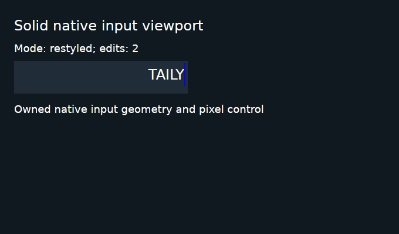

# Native input viewport qualification failure: November 4, 2026

This research archive preserves the three executed failures from
[Validation 41907537790, Native Linux job 126846102655](https://github.com/0xPlayerOne/bun-native/actions/runs/41907537790/job/126846102655)
for [PR #377](https://github.com/0xPlayerOne/bun-native/pull/377). It changes no
product source, workflow, deadline, assertion or GC checkpoint. No application,
native host, failed test or hosted job was executed again to prepare it.

## Exact source and outcomes

| Identity          | Recorded value                                                     |
| ----------------- | ------------------------------------------------------------------ |
| Pull request head | `af956a154fff0c0afcc5e26adbe55f5af76f9f1b`                         |
| Tested merge      | `44334f79d05e8cdca9bb0298871f6aea9236b2b0`                         |
| Tested tree       | `1a9d22268ed5e0c86b3e6fd5dfd5efe7f61995f2`                         |
| Platform          | Linux x64, isolated X11/XTest, software llvmpipe                   |
| Bun revision      | `da867c60bf0bcbf9d6d36994f8ca0efa42075115`                         |
| Native host       | Release, 29,507,712 bytes                                          |
| Host SHA-256      | `e44aaf38c28f08f6070513d0f24201d3efce1c38a7879b0b55ab539f6ddb4ae4` |

The actual host bytes in the original unsigned archive match the recorded size
and digest. Both 117-file native failure inventories and all 89 sorted, unique
viewport package source records match the exact tested tree. The retained
130,376-byte development module matches SHA-256
`e5fde7fbb9b133cee78ae58c717899c17023e6c496af11effb2e9d50399084a7`.
These are source and byte checks, not new execution evidence.

| Failed step                          | Original observation                                                                          | Scope                                                                                                                                                                        |
| ------------------------------------ | --------------------------------------------------------------------------------------------- | ---------------------------------------------------------------------------------------------------------------------------------------------------------------------------- |
| 15: Development public API lifecycle | `Native open request 3 timed out`                                                             | The existing open deadline was exceeded; no viewport scenario ran here.                                                                                                      |
| 38: Solid local-stream workspace     | The fixture exited before its mounted tree; stderr records `Native open request 2 timed out`. | Application exit 1, unforced cleanup, no remaining or unreaped observed processes; its AOT case did not run.                                                                 |
| 41: Shared input viewport            | Solid development timed out waiting for `actual restyled-end pixels`.                         | The pixel classifier misidentified one glyph-fringe pixel; the controller ultimately forced SIGTERM, application exit -15, with no remaining or unreaped observed processes. |

The two open-request failures remain unexplained under
[#296](https://github.com/0xPlayerOne/bun-native/issues/296). They are independent
of the viewport pixel classifier. The same run's Ubuntu Protocol callback
retention failure is preserved separately in
[archive #383](https://github.com/0xPlayerOne/bun-native/pull/383) and remains
open under [#287](https://github.com/0xPlayerOne/bun-native/issues/287). Nine other
implementation jobs passed; the aggregate Validation gate failed.

## Concrete pixel-classifier defect

At the recorded restyled frame, input node 7 has viewport `[28, 108, 288, 39]`,
caret bounds `[314, 108, 2, 39]`, line width `793.51171875` and offset
`507.51171875`. All **78 actual opaque blue caret pixels** are at the expected
right edge. The original broad blue-color predicate additionally counted the
single pixel at **(266, 133), RGB (32, 99, 183)** as a misplaced caret. Its
neighborhood is the LCD-antialiased edge of the white glyph over background
RGB (32, 44, 56). The independently inspected screenshot and exact RGB values
establish an oracle classification defect, without a geometry-failure claim.

The original recorded counts are 293 inside-glyph pixels, zero outside-glyph
pixels, 78 expected caret pixels, **one misplaced-caret pixel**, and zero
outside-selection pixels. The original predicate therefore failed. File-only
evaluation of a corrected classifier is separately labeled in the audit; it
does not turn the original hosted run into a pass. Zero misplaced genuine
caret pixels and all existing clipping/missing-caret requirements remain the
intended contract.

For comparison, the original [resized frame](resized-end.png) passed its
unchanged pixel predicate before font restyling. All seven retained frames
match the complete native tree, current application state and original records;
the fresh native/public pointer pair matches the captured offsets. Original
End, Home and resized screenshots reproduce their passing recorded counts.
The one-character selection has geometry and a screenshot, without a separate
selection pixel-count assertion.

The full Ctrl+A selection/clipping, clear/reset, short-text and final OS-close
phases **did not run**. No final zero-owner application-disposal record exists
for this failed viewport case. Solid AOT and both React viewport cases were
also unexecuted. An AOT build manifest exists, but its application binary was
not retained and the new AOT viewport scenario was not executed.

## Archive contents and exact omissions

The original GitHub artifact `13361963848` is **15,304,564 bytes**, SHA-256
`d5deb1b7dc72b7aeb3ba6f2823cb4401d2236bed941b4108ae51878e6297592b`.
Its complete inventory contains 548 unique regular files. The
[inventory](archive-inventory.json.raw) identifies every original member by
size and SHA-256 and marks whether its bytes are copied here.

[original-failure-evidence.tar.gz](original-failure-evidence.tar.gz) preserves
**53 exact files**, totaling **1,652,305 uncompressed file bytes**. The archive
is **255,777 bytes**, SHA-256
`02700f192a43559bd71f95cfa589dc972da6432eafe2b0ea78ad831bc59f4912`.
It includes all three failure directories, their observations/screenshots/logs,
toolchain and host hash/size records, both relevant package command and manifest
receipts, and the entire decoded job log. Archive preparation verified safe,
unique regular paths and every byte against the original ZIP or job log.

The decoded job log is archived as `complete-job-126846102655.log`: **282,600
bytes**, SHA-256
`394131b65acab5c5087a1542c5f99c845a9eb0e5a16b738310bb044963745c36`.
Paths beginning with `raw/` in the [failure audit](failure-audit.json.raw)
refer to the original artifact root; the archive uses the corresponding
relative path without that prefix. The audit is unchanged authored analysis,
**16,910 bytes**, SHA-256
`75b64797d9ee22f815bd3cb73f611e9f2d76f6664378517f65f51611e25fa2a4`.

The complete original ZIP, unrelated successful-case payloads, generated
JavaScript/source maps and executable binaries are **not** copied into this
research branch. Their original identities and explicit omission flags remain
in the inventory. The two displayed PNGs are exact additional copies of the
original archive members. This is a bounded failure archive, not a replacement
for the entire original native artifact or a newly accepted qualification.
